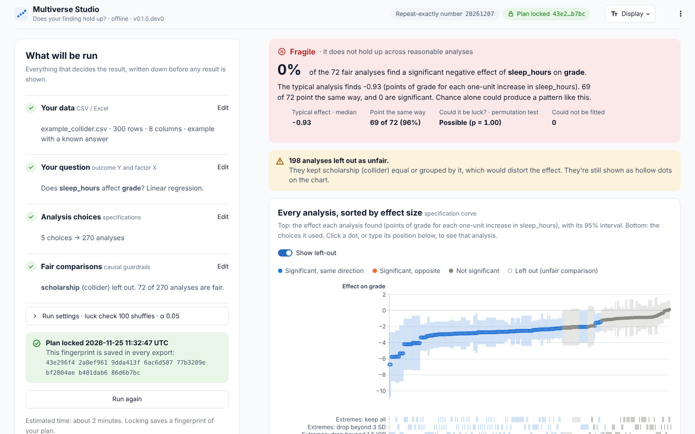
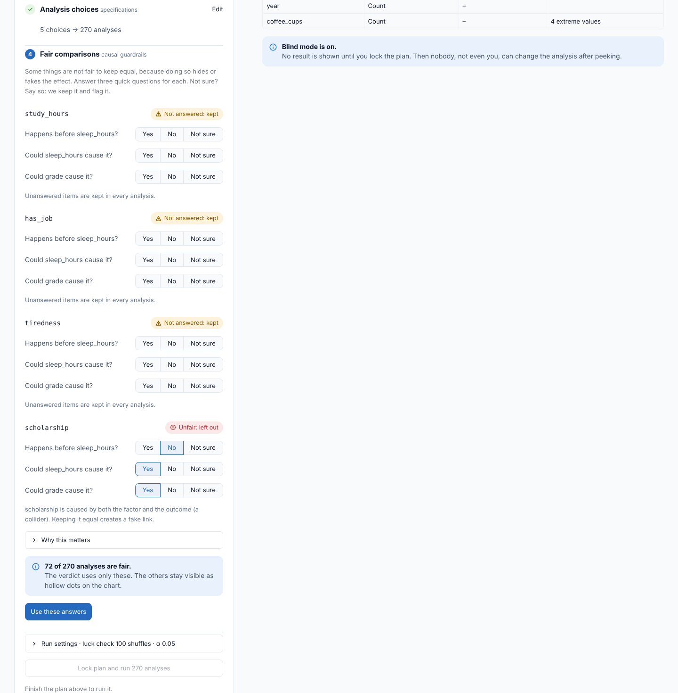
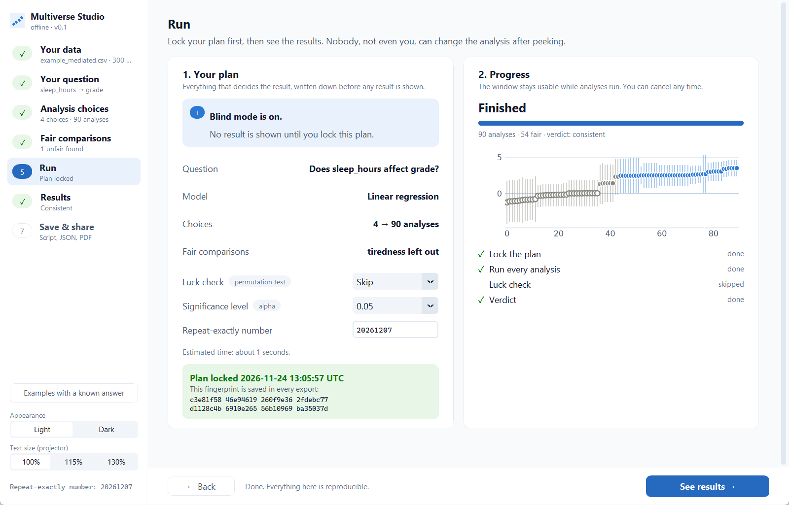
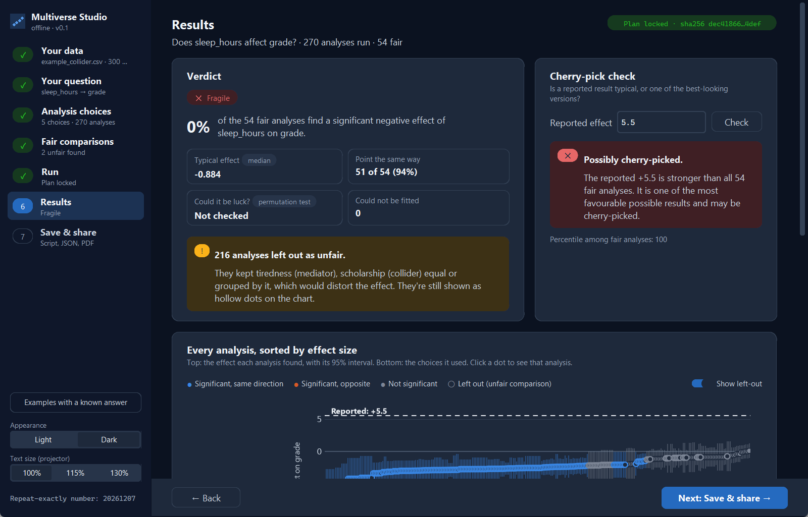

# Multiverse Studio

**Does your finding survive every reasonable way of analysing it? Find out without writing code.**

Multiverse Studio is a free app that runs entirely on your computer, for **multiverse / specification-curve analysis**, built for researchers, analysts, reviewers and students who don't program. You load a CSV or Excel file, pick your question (does X affect Y?), and tick the analysis choices a careful researcher could defend. The app runs every combination and shows whether your result is **consistent** or **fragile**.



What makes it different from existing tools such as specr, RobustiPy and Boba:

- **No code.** The whole workflow is point-and-click in a local browser page, and it exports a reproducible Python script.
- **Causal guardrails.** Three plain questions per variable flag *bad controls* (mediators, colliders) and bad subgroups, and exclude those analyses from the verdict.
- **Blind mode.** You lock your analysis plan with a SHA-256 fingerprint *before* any result is shown, and anyone can verify it afterwards.
- **Cherry-pick check.** Shows where a reported result sits among all fair analyses.
- **Examples with a known answer.** Five simulated datasets (real effect, no effect, hidden common cause, mediator trap, collider trap) for learning and teaching.

> Status: **in development** (v0.1.0.dev0).

## Install

```bash
pip install multiverse-studio        # after the first PyPI release
multiverse-studio                    # starts the app and opens it in your browser
```

From source:

```bash
git clone https://github.com/omargh007/multiverse-studio.git
cd multiverse-studio
python -m venv .venv
# Windows: .venv\Scripts\activate    Linux/macOS: source .venv/bin/activate
pip install -e ".[dev]"
python -m multiverse_studio
```

Requires Python 3.10 or newer on Windows, Linux or macOS. The app runs on a local server at `http://localhost:8501`, reachable only from your own computer, so your data never leaves it. Close the terminal window (or press `Ctrl+C`) to stop it.

## Using the app

One page, two columns. On the left is **the plan**: four blocks that unlock in order, each folding into a one-line summary you can reopen with **Edit**. On the right is **the evidence**: your data before a run, live progress during it, then the results.

| Plan block | What you do |
|---|---|
| 1. Your data | Load a CSV/Excel file, a saved analysis, or an example with a known answer. |
| 2. Your question | Pick the outcome (Y) and the factor (X). The model is chosen for you. Blind mode is on by default. |
| 3. Analysis choices | Tick the defensible options: extreme values, things to keep equal, who to include, missing answers. |
| 4. Fair comparisons | Answer three Yes / No / Not sure questions per variable. Unfair ones are left out. |
| Run | Lock the plan, then every analysis runs in the background with a live preview. |

The results show the verdict in one plain sentence, the specification curve (click any dot to see that analysis and its code), which choice matters most, the cherry-pick check, ready-to-use methods and results text, and **Save & share**: the Python script, the JSON report, the analysis file, a PDF report and a check that the plan still matches its fingerprint.

Light and dark mode: the ⋮ menu at the top right → Settings. A **Display** button sets the text size (100 / 115 / 130%) for classroom projectors.

| Fair comparisons | Running | Dark mode |
|---|---|---|
|  |  |  |

## Quick start (script, no GUI)

```python
from multiverse_studio.core import api
from multiverse_studio.io.loaders import load_table

df = load_table("survey.csv")
profile = api.profile_data(df)
family = api.suggest_family(profile, "grade")
decisions = api.suggest_decisions(profile, "grade", "sleep_hours", df)
specs = api.build_specs(decisions, max_specs=1000, seed=42)
results = api.run_multiverse(df, "grade", "sleep_hours", family, decisions, specs)
print(api.summarize(results).explanation)
```

## Development

```bash
pytest --cov            # tests + coverage (GUI test skips itself without a display)
ruff check src tests    # lint
```

- Project status and open tasks: [docs/STATUS.md](docs/STATUS.md)
- Contributor rules: [CLAUDE.md](CLAUDE.md)
- Architecture: [docs/architecture.md](docs/architecture.md)
- Design decisions (verdict rule, seed, processing order, guardrails): [docs/decisions.md](docs/decisions.md)
- Product and design brief: [PRODUCT.md](PRODUCT.md), [DESIGN.md](DESIGN.md)
- Novelty search and feature plan: [docs/planning/](docs/planning/)

## Cite

See [CITATION.cff](CITATION.cff). A Zenodo DOI will be added with the first release.

## License

MIT. See [LICENSE](LICENSE).
