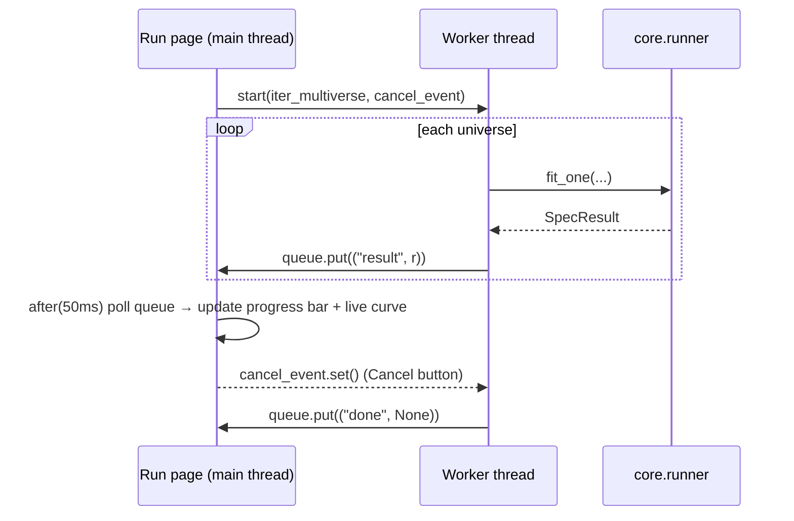

# Architecture

## Principles
1. **Core never imports the GUI.** `core/`, `io/` and `plots/` work in scripts and tests with no display. A test (`tests/core/test_no_gui_imports.py`) enforces this.
2. **One shared state.** The `Session` dataclass (`core/types.py`) holds everything about an analysis. Every GUI page reads and writes it, and every export starts from it.
3. **The GUI only calls `core.api`.** The GUI contains no analysis logic.
4. **Long work runs off the main thread.** The core runner reports through callbacks, and the GUI forwards them to a queue that it polls with `after()`.
5. **One seed, one purpose per random step** (`core/seed.py`, decision D-3).

## Layers

```mermaid
flowchart TB
    subgraph GUI["gui/ (CustomTkinter)"]
        APP[app.py<br/>window + sidebar wizard]
        PAGES[pages/<br/>data, question, choices,<br/>guardrails, run, results, export]
        WORKER[worker.py<br/>thread + queue + after()]
        THEME[theme.py<br/>design tokens]
    end

    subgraph PLOTS["plots/ (Matplotlib Figures)"]
        SC[spec_curve.py]
        IMP[importance.py]
    end

    subgraph CORE["core/ (no GUI)"]
        API[api.py - public facade]
        TYPES[types.py - Session and contract]
        PROF[profiling.py]
        CH[choices.py]
        SPECS[specs.py]
        MOD[models.py - statsmodels]
        RUN[runner.py]
        INF[inference.py - verdict + permutation]
        GR[guardrails.py *novel*]
        BL[blind.py *novel*]
        CP[cherry.py *novel*]
        IM[importance.py]
        SIM[simulate.py]
        NAR[narrative.py]
        SEED[seed.py]
    end

    subgraph IO["io/"]
        LOAD[loaders.py]
        SCRIPT[export_script.py]
        JSON[export_json.py]
        PDF[export_pdf.py]
        STORE[session_store.py]
    end

    PAGES --> API
    PAGES --> WORKER
    PAGES --> SC & IMP
    PAGES --> LOAD & SCRIPT & JSON & PDF & STORE
    WORKER --> API
    API --> PROF & CH & SPECS & RUN & INF & GR & BL & CP & IM & SIM & NAR
    RUN --> MOD
    INF --> RUN
    SPECS & INF & BL & SIM --> SEED
    SCRIPT & JSON & PDF & STORE --> TYPES
    PDF --> SC & IMP
```

## User workflow (wizard steps)

| Step | Page | Core calls | Writes to `Session` |
|---|---|---|---|
| 1. Data | `pages/data.py` | `load_table`, `profile_data` | `data_path`, `profile` |
| 2. Question | `pages/question.py` | `suggest_family` | `y`, `x`, `family` |
| 3. Choices | `pages/choices.py` | `suggest_decisions`, `count_specs` | `decisions`, `max_specs` |
| 4. Guardrails | `pages/guardrails.py` | `assess_controls` | `guardrails`, `assessments` |
| 5. Run | `pages/run.py` | (blind) `blind_view`, `lock_plan` → `build_specs`, `iter_multiverse`, `mark_validity`, `permutation_test`, `summarize` | `blind`, `specs`, `results`, `verdict` |
| 6. Results | `pages/results.py` | `decision_importance`, `cherry_pick_check`, plots | `reported_estimate`, `cherry_pick` |
| 7. Export | `pages/export.py` | `export_script`, `export_json`, `export_pdf`, `methods_paragraph`, `results_paragraph`, `save_session` | none |

**Teaching mode** (sidebar button) calls `simulate(scenario)` and opens the result at step 2, so students can watch a known truth appear or disappear.

## Threading (step 5)



## Changing the contract
`core/types.py` and the function signatures in `core/api.py` are shared. To change them:
1. Make a small change that touches **only** the contract.
2. Tell the team before merging it.
3. Then update the code that uses it.

## Git workflow
- Pull before you start working, and commit small changes often.
- Keep CI green: run `ruff check src tests` and `pytest --cov` before pushing.
