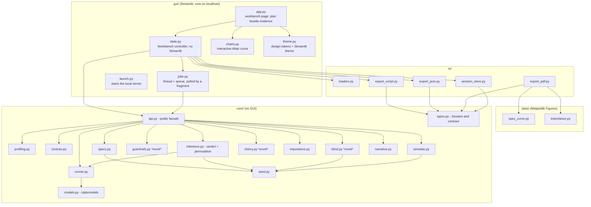
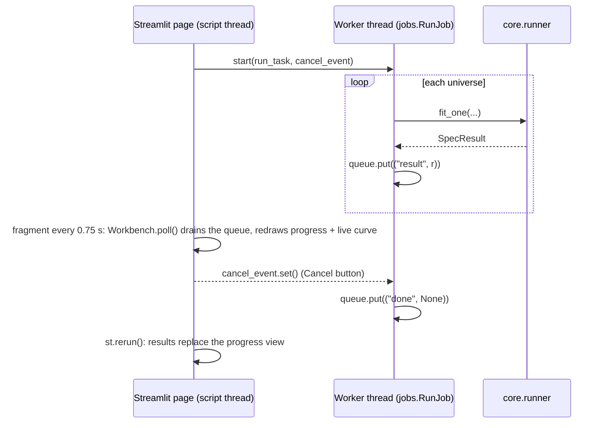

# Architecture

## Principles
1. **Core never imports the GUI.** `core/`, `io/` and `plots/` work in scripts and tests with no display. A test (`tests/core/test_no_gui_imports.py`) enforces this.
2. **One shared state.** The `Session` dataclass (`core/types.py`) holds everything about an analysis. Every GUI page reads and writes it, and every export starts from it.
3. **The GUI only calls `core.api`.** The GUI contains no analysis logic.
4. **Long work runs off the main thread.** The core runner reports through callbacks; `gui/jobs.py` runs it in a worker thread that puts messages on a queue, and the Streamlit page polls that queue with a fragment on a timer (`st.fragment(run_every=...)`).
5. **One seed, one purpose per random step** (`core/seed.py`, decision D-3).

## Layers

## User workflow (one page: plan beside evidence)

The left column is the plan, four blocks that unlock in order. Each finished block folds into a one-line summary with an **Edit** button. The right column is the evidence: the data overview before a run, live progress during it, then the results.

| Plan block | Controller methods (`gui/state.py`) | Core calls | Writes to `Session` |
|---|---|---|---|
| 1. Your data | `load_upload`, `load_example`, `load_session_file` | `load_table`, `profile_data`, `simulate` | `data_path`, `profile` |
| 2. Your question | `set_question`, `set_blind` | `validate_question`, `suggest_family` | `y`, `x`, `family` |
| 3. Analysis choices | `ensure_suggestions`, `set_ticked`, `set_limit`, `confirm_choices` | `suggest_decisions`, `count_specs` | `decisions`, `max_specs` |
| 4. Fair comparisons | `set_answer`, `confirm_fairness` | `assess_controls`, `variables_to_assess` | `guardrails`, `assessments` |
| Run | `set_run_options`, `start_run`, `poll`, `cancel` | `lock_plan`, `build_specs`, `iter_multiverse`, `mark_validity`, `permutation_test`, `summarize` | `blind`, `specs`, `results`, `verdict` |
| Results (right column) | `check_cherry`, `importance`, `single_code` | `cherry_pick_check`, `decision_importance`, `methods_paragraph`, `results_paragraph` | `reported_estimate`, `cherry_pick` |
| Save & share | `script_text`, `report_text`, `session_text`, `plan_matches` | `render_script`, `report_dict`, `session_to_dict`, `verify_plan` | none |

`app.py` only draws and wires widgets to these methods (through `on_change` callbacks). Because `Workbench` has no Streamlit import, the whole workflow is tested with plain pytest (`tests/gui/test_state.py`); `tests/gui/test_app.py` also drives the real page headlessly with Streamlit's `AppTest`.

**Examples with a known answer** (step 1) call `simulate(scenario)`, so students can watch a known truth appear or disappear.

## Threading (Run)

## Running it
`multiverse-studio` (or `python -m multiverse_studio`) calls `gui/launch.py`, which starts Streamlit's server on **localhost only**, turns off usage statistics, applies the design tokens as Streamlit's light and dark themes, and opens the browser. Data never leaves the computer.

## Changing the contract
`core/types.py` and the function signatures in `core/api.py` are shared. To change them:
1. Make a small change that touches **only** the contract.
2. Tell the team before merging it.
3. Then update the code that uses it.

## Git workflow
- Pull before you start working, and commit small changes often.
- Keep CI green: run `ruff check src tests` and `pytest --cov` before pushing.
